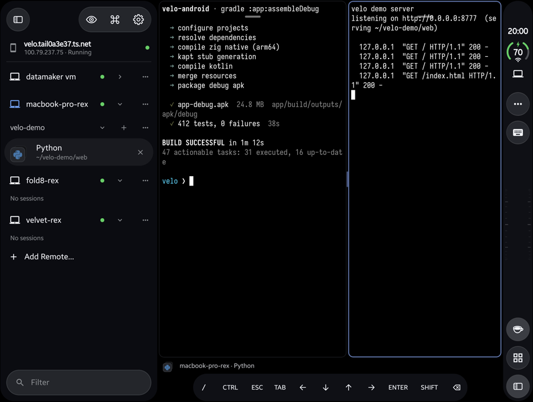
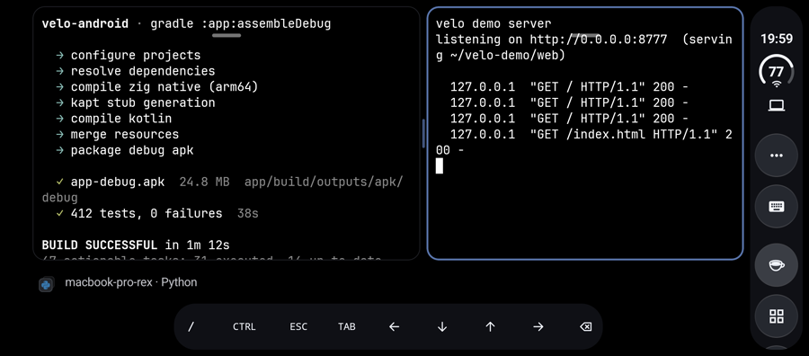
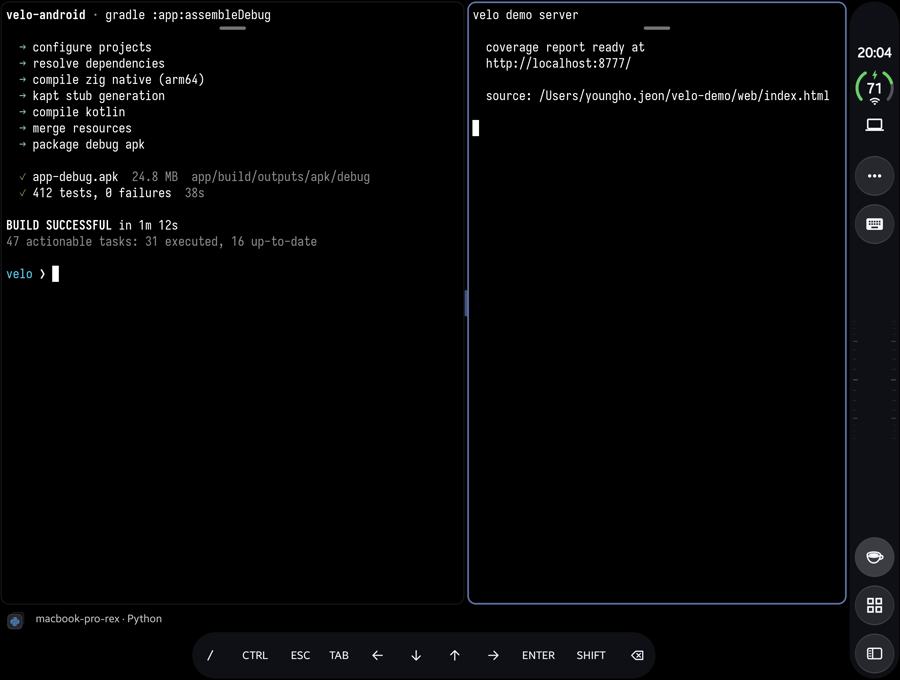
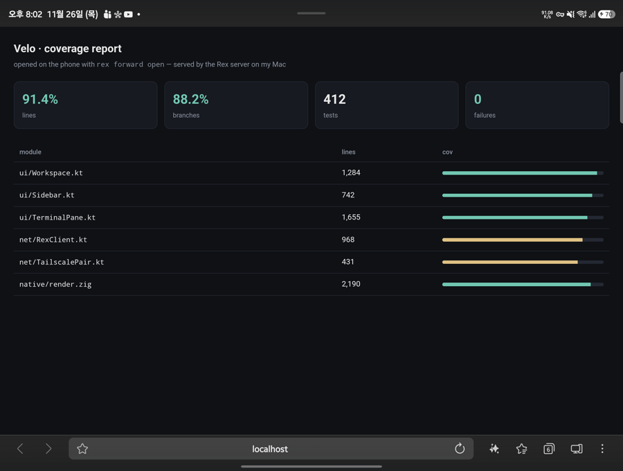

Velo: an unofficial Android client for Rex (terminal blocks only).


[](https://github.com/yhzion/velo-android/releases)
[](https://github.com/yhzion/velo-android/releases/latest)
[](#open-your-first-session)
[](#open-your-first-session)

I built Velo because I wanted to use Rex away from my desk. The name is the velociraptor: a small, fast dinosaur — a terminal that fits in your pocket. Look for the velociraptor in sunglasses on your home screen. Velo is unofficial, noncommercial, and not affiliated with Superlogical. Rex is only the product Velo connects to; Superlogical does not make, support, or endorse this independent Android client.

## What you can do

- Switch between sessions and tabs across multiple Rex servers from the sidebar.
- Unfold your phone to see terminal panes side by side. Drag the divider to resize them.
- Use the row above the on-screen keyboard to enter special keys.
- Choose which panes notify you when a task finishes, needs a reply or fails. Tap a notification to return to that pane.
- Tap an address or a file path the terminal printed to open it on the phone: Velo forwards the port, or copies the file and hands it to the app your phone uses.
- Let a coding agent open its own pane for a job and close it when the job is done.

## An agent runs its own pane

Ask a coding agent in one pane to do a job, and it opens a second pane for the work, reads what the command printed, and closes the pane when it is done. Rex's agent skill gives Claude Code and Codex the commands; Velo draws the panes as they come and go, so you watch the job from the phone without typing the commands yourself.


## One layout per shape

Rex keeps the split, so you pick the direction that suits the way you are holding the phone. Side by side uses the width of an unfolded Fold8, or of any phone turned on its side. Stacked gives each terminal the full width when the phone stands upright. Drag the divider to resize either way.

|  | side by side | stacked |
| --- | --- | --- |
| Fold8, unfolded |  |  |
| Fold8, cover screen |  |  |
| Bar phone (LG Velvet) |  |  |

## Open what the terminal printed

Tap a `localhost` address a server printed, and Velo forwards that port from the Rex server to the phone and opens the page in your browser. Tap a file path, and Velo copies that file from the server and hands it to the app your phone uses for its type.

| the address in the terminal | the page on the phone |
| --- | --- |
|  |  |

A file path opens the same way, through the app your phone already uses for that type.


## Open your first session

You need a 64-bit ARM device running Android 11 or later and a computer running a Rex server. Velo connects to the server; it does not run one.

1. Download `velo-<tag>-arm64-v8a.apk` from [GitHub Releases](https://github.com/yhzion/velo-android/releases/latest) and install it on your phone. The `.sha256` file beside it holds the APK's digest.
2. Add the server, over Tailscale or by its address, as described below.
3. Open the server and select the session and tab you want to continue.

### Over Tailscale

Velo runs its own Tailscale node, so the phone needs no Tailscale app or VPN.

The tailnet needs MagicDNS and HTTPS certificates. Its admin turns them on in the DNS page of the admin console: enable MagicDNS if it is off, then under **HTTPS Certificates** select **Enable HTTPS** (see [Enabling HTTPS](https://tailscale.com/kb/1153/enabling-https)). Each certificate goes into a public ledger, so the machine name of the server's node and the tailnet DNS name become public. Without MagicDNS and HTTPS certificates, Velo finds no server ("No computer that runs Rex was found on this tailnet."), and `rex server tailscale pair` fails. After step 1, `rex server status` on the computer shows an `https:` address under `tailscale:` when the tailnet is ready.

1. On the computer running Rex, run `rex server tailscale on`. The server then serves its API on your tailnet. The first time, it asks you to log in: the login link appears in the server log and in `rex server status`. The setting lasts until the server restarts; start the server with `--tailscale` to keep it. To let other members of the tailnet in too, run `rex server tailscale on --allow-tailnet-members`; to keep that, start the server with `--tailscale-allow-tailnet-members`. Every member the tailnet's access rules admit can then reach the server. A later plain `rex server tailscale on` turns members off again, so pass `--allow-tailnet-members` every time you run it.
2. In Velo, tap **Log in to Tailscale** and log in once, in the browser, with the Tailscale account that owns the server's node. If the server lets other members in (step 1), a member logs in with their own account.
3. Velo lists the Rex servers it finds on that tailnet. Tap **Connect** beside one; Velo saves it and connects.

Instead of step 3, you can scan the server's QR code. On the computer, run `rex server tailscale pair`. In Velo, choose **Add by QR code or address**, then **Scan QR code**. The code holds only the server's tailnet address, so the phone must be on the tailnet first (step 2).

**Log in to Tailscale** and **Add by QR code or address** are on the start screen, which Velo shows only while no server is saved. After that, log in under **Settings → Remotes → Tailscale**, and add a server with **Add Remote…** in the sidebar or in **Settings → Remotes**. The sidebar also lists the servers found on the tailnet.

### By address

On the start screen, choose **Add by QR code or address**; later, choose **Add Remote…**. Type the address and tap **Add**.

While Velo's Tailscale node is running, Velo opens every `https://` and `http://` connection through it. The node passes a host outside the tailnet on to the phone's own network. In any other state, such as off or waiting for a login, Velo connects over the phone's own network. An `ssh://` address goes through the node only when its host is on the tailnet.

An address outside a tailnet needs no Tailscale login. A tailnet name such as `rex.example.ts.net` resolves only on the tailnet: log in to Tailscale in Velo, or run the Tailscale app on the phone, with an account the server admits (step 2).

| You type | Velo connects to |
| --- | --- |
| `rex.example.ts.net` | HTTPS on port 443: an address without a scheme is HTTPS |
| `rex.example.com:8443` | HTTPS on port 8443 |
| `https://192.0.2.29`, `https://[2001:db8::1]:8443` | HTTPS to an IPv4 or IPv6 address |
| `http://192.0.2.29:7890` | plain HTTP, without TLS |
| `ssh://user@rex.example.com`, `ssh://user@host:2222` | that user's Rex server on that host, over SSH (port 22 unless you give one) |

HTTPS to an IP address works only when the server's certificate names that address. Rex's tailnet certificate names only its `ts.net` name, so `https://100.x.y.z` fails the certificate check: use the `ts.net` name instead.

Velo refuses an address that holds a password (`https://me:pw@host`), a user name outside `ssh://` (`https://me@host`), an SSH address without a user (`ssh://host`) or with a path after the host, and other schemes such as `wss://`.

Velo does not encrypt `http://`. To a server on your tailnet, Tailscale encrypts the traffic; anywhere else, use `https://` or `ssh://`.

Over SSH, Velo logs in with the phone's own key, a key you import, a password or the host's prompts. The first time, it shows the host key's fingerprint and asks you to trust it. If the host later presents another key, Velo blocks the connection. It then finds the Rex server's socket on that host as the desktop app does, and starts the server if it is not running.

Velo also takes a socket path (`/path/to/rex.sock` or `unix:///path/to/rex.sock`), but that path is on the phone. Android keeps each app's files to itself, so Velo cannot open the socket of a Rex server that another app, such as Termux, runs on the same phone. To reach a Rex server in Termux, use Termux's SSH server (`ssh://user@127.0.0.1:8022`) or that server's own tailnet name. To reach the socket on a computer, use its `ssh://` address.

## Update the app

If you have Velo v2.9.17 or an earlier build tied to the old private repository, download the first public APK from [Velo's releases](https://github.com/yhzion/velo-android/releases) and install it as an update once. **Do not uninstall the existing app.** An in-place upgrade requires the same package name and signing certificate and a higher version code. If Android rejects the update, stop rather than deleting saved servers, settings, or SSH keys. The public build checks the new repository for subsequent updates.

Open **Settings → About → Updates** to check for new versions or enable update notifications. Stable (the default) offers stable Velo releases only. Preview also includes preview builds; Edge adds experimental builds on top of both. Switching channels never downgrades the installed app.

Background checks run roughly every 12 hours when connected. They never download an APK. To update Velo, choose **Download update**, then **Install update**. Android may ask whether this app can install updates. Velo checks the APK digest, package, version and signing certificate before opening Android's confirmation screen.

## Terminal fonts

Velo defaults to stock JetBrains Mono and uses D2Coding for Hangul. Basic Powerline symbols still work, but Nerd Font icons are no longer bundled. On upgrade, a saved JetBrains Mono choice switches to the stock font; a saved Jetendard choice uses D2Coding.

To restore Nerd icons in the terminal, import your own font once on each device:

1. Obtain a Nerd Font Mono from its publisher. Extract the download and save the Regular `.ttf` file on your device (for example, `JetBrainsMonoNerdFontMono-Regular.ttf` in Downloads).
2. In Velo, open **Settings → Appearance → Font**, then tap **Import font…**.
3. In the Android file picker, open **Downloads** (or the folder where you saved the file) and tap the font file, not the ZIP. Velo copies and selects the font. To switch back to it later, open **Font** and select the imported row.

The picker takes one TTF, OTF, or TTC file at a time. A Regular TTF supplies one face; Android handles bold and italic when those designs are missing. If you import the separate Bold, Italic, and Bold Italic TTFs, each becomes its own choice and the last import is selected. Velo cannot combine them. If you already have a TTC that holds all four faces under the same embedded family name, pick that single TTC instead to use all four designs. Imported glyphs are available when the imported font is selected; they are not a fallback for other font choices.

## QR scanning and privacy

ZXing reads pairing QR codes on your device. The scanner does not upload camera frames, decoded results, or scanner usage metrics. Velo takes only an `https://` address from a code. On the start screen's **Add by QR code or address**, Velo saves that server and connects to it. In **Add Remote…**, the scan only fills the address field, and you tap **Add**. Velo refuses a code that holds anything else, such as an `ssh://` login or a socket path: type that address instead. You can enter a server address instead of granting camera access.

## Build from source

On x86-64 Linux, use JDK 25, Gradle 9.6.0, Zig 0.17.1, and the [Go version pinned by the project](native/tailscale/go.mod). Install the Android SDK and NDK versions listed in the [release workflow](.github/workflows/release.yml), then set `ANDROID_HOME` to your SDK directory.

```sh
gradle :app:assembleDebug
```

The debug APK is written to `app/build/outputs/apk/debug/app-debug.apk`.

[Native architecture](docs/native-architecture.md) · [Signing and releases](docs/releasing.md) · [Issue tracker](https://github.com/yhzion/velo-android/issues)

## License

Velo's original code and assets are licensed under the [MIT License](LICENSE). Third-party components in the source tree and APK retain their own licenses and terms; see [NOTICE](NOTICE) and the license texts in [licenses/](licenses/). The app shows the same texts offline under **Settings → About → Open source licenses**.

## Acknowledgements

Velo exists because of [Rex](https://www.superlogical.com/) and
[Ghostty](https://ghostty.org/). Thank you to Mitchell Hashimoto and the
Rex team for building them, and for kindly allowing this unofficial client
to be shared.

Velo is not affiliated with or endorsed by the Rex authors.
